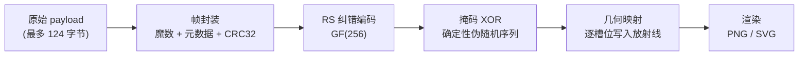
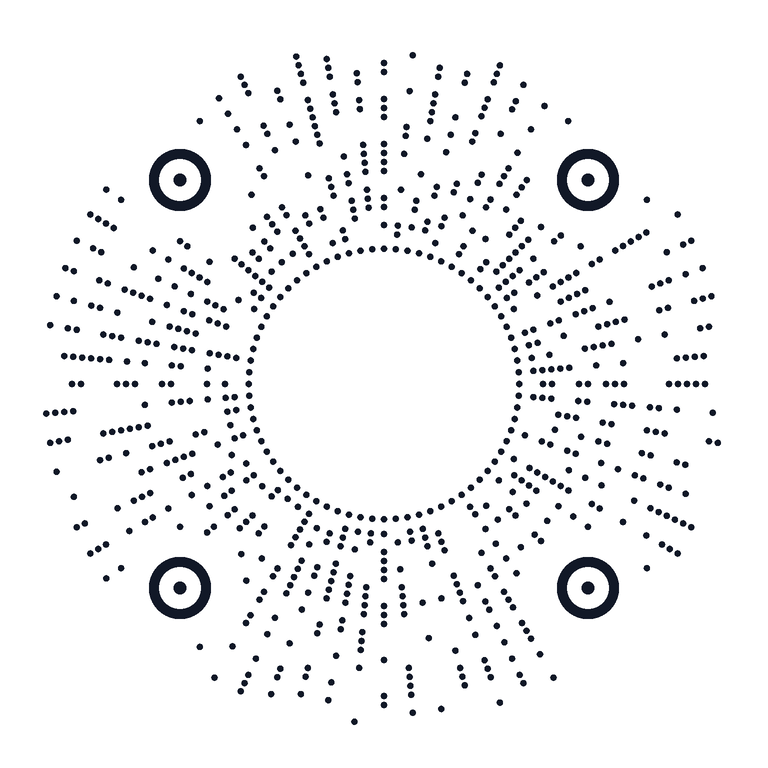
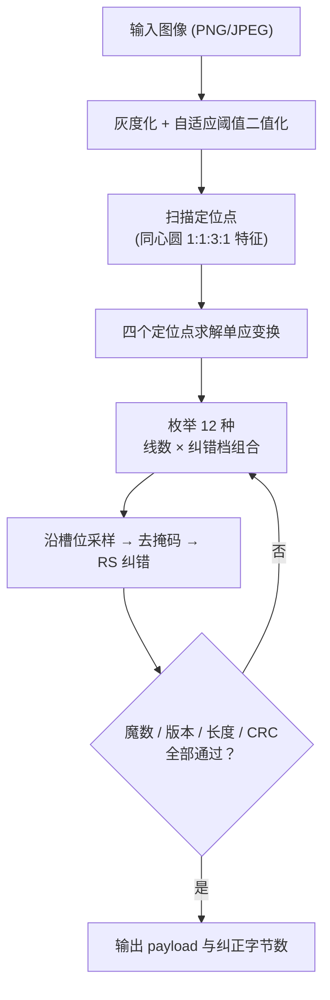
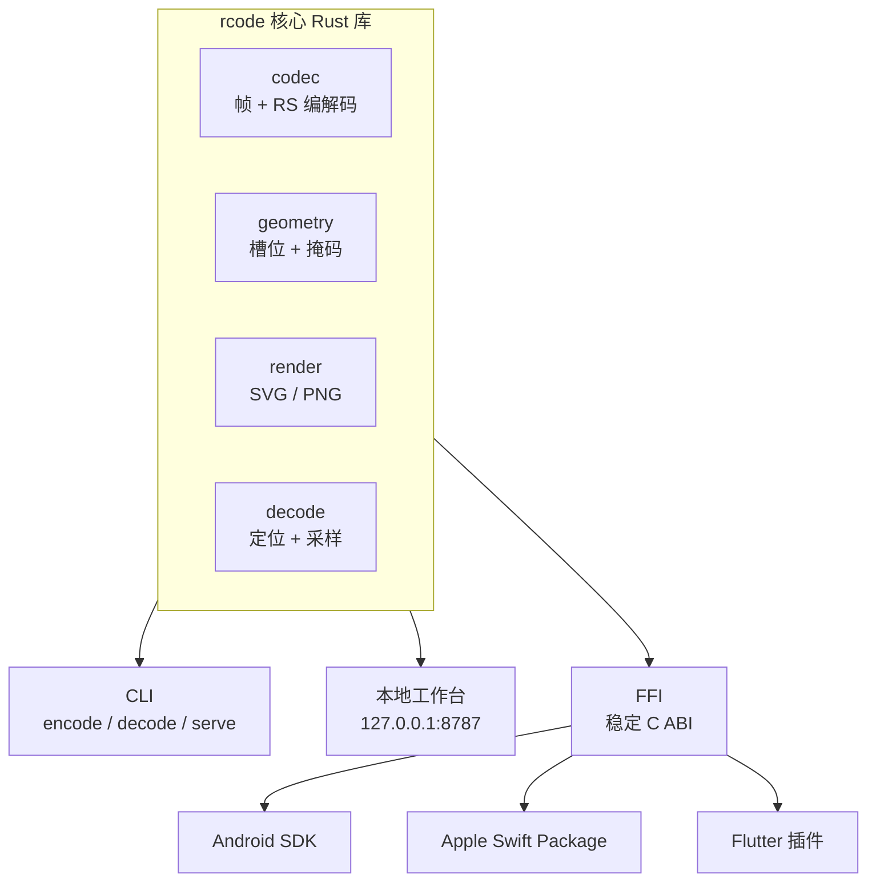

# 我用 Rust 造了一个小程序码

两年前我写过一篇[《小程序码生成技术分析》](/blog/analysis-of-mini-program-code-generation-technology)。那篇文章搞清楚了微信小程序码的大部分秘密：射线状的数据分布、与 QR 码一致的 RS 纠错、32 种掩码。但也留下了不少"目测"、"疑似"、"巧合发现"——彼时的我对着一张张截图数像素，能走到那一步已经是极限。

两年后，借助 AI 把每个模糊的环节都掰开揉碎讲透，我终于把这些推测变成了可以运行、可以验证的代码。这篇文章记录的，就是 **[RCode](https://github.com/charles0122/rcode)** ——一个用 Rust 写的、开放的放射状码系统——从零到诞生的过程。

<!-- truncate -->

先看成品。下面这张码用 RCode 生成，内容是一句话，中央嵌入了本站的 Logo：


## 一、两年前留下的问号

回顾 2024 年那篇分析文章，当时的结论大致是这些：

**搞清楚了的部分：**

- 小程序码有 36 / 54 / 72 线三个版本，数据点从内向外、逐线顺时针映射；
- 元数据区域的位置在三个版本中一致，解码时可以在不知道版本的情况下先读到它；
- 纠错编码与 QR 码完全一致，是 GF(256) 上的 RS 码；
- 数据最后会与 32 种掩码之一做异或。

**没搞清楚的部分：**

- 微信码的 payload 经过了 `Base82 -> Base256 -> Base45` 的转换，最终拿到的看起来是**加密数据**——内部编码无从得知，只能止步于此；
- 32 种掩码的具体生成规则未知，只能逐一试错；
- "数据点与比特的映射关系"靠目测归纳，没有源码级的验证。

这就是逆向分析的天花板：**你能知道它是怎么运作的，但拿不到它的全部规格，更不能把它变成自己的东西。** 想拥有一个"菊花码"，在当时只剩下等微信开放 API 这一条路。

## 二、AI 时代重新拆解这个技术

两年后我重新翻出这篇文章，换了一种问法：与其继续抠微信的私有协议，**不如把已验证的那套思想拿过来，设计一个完全属于自己的放射状码制**。

这一次，AI 帮我把每个环节都变成了精确的规格：

- **RS 纠错**不再是"和 QR 码一致"这句话，而是明确的 GF(256)、生成多项式 0x11d、码字长度、校验字节数、可纠错字节数 t = ⌈n×p⌉ 这些可以写进代码的数字；
- **掩码**不再需要试错——自己设计的码制里，掩码可以是一个确定性的伪随机函数，任何人（包括 AI）用任何语言都能逐位复现；
- **几何映射**不再靠目测，而是 128×128 逻辑画布上一个可以推导、可以画图验证的坐标公式。

把微信码的公开设计资料和 QR 码的标准拼在一起，一个完整的编码流水线就浮现出来了：



这条流水线就是 RCode 的骨架。剩下的工作，是把它变成一个正经的软件。

## 三、RCode 是什么，不是什么

先划清边界：**RCode 是自建协议，不兼容微信小程序码，也不能被标准 QR 扫码器识别。** 这不是技术缺陷，而是刻意的设计决策——复刻微信码有法律风险，而且微信码的 payload 是加密的，复刻了外壳也装不进自己的内容。RCode 的目标是"开放"：任何人都可以按照公开的[协议文档](https://github.com/charles0122/rcode/blob/main/docs/format.md)实现自己的编解码器。

| 设计目标 | 取值 |
| --- | --- |
| 几何版本 | 36 / 54 / 72 线，解码自动识别 |
| 纠错档位 | L / M / Q / H（目标 10% / 15% / 25% / 35%） |
| 单码容量 | 13 ~ 124 字节 |
| 输出格式 | PNG / SVG，384 ~ 2048 px |
| 视觉样式 | 放射线条（lines）/ 圆点（dots） |
| 解码容错 | 旋转、等比缩放、平移、轻度噪声、适度透视 |
| 技术栈 | 纯 Rust，无 Node、无数据库、无外部服务 |

为什么坚持用纯 Rust + 零外部服务？因为我希望它能一路走到手机上——后面会讲到，FFI 层已经打通了 Android / Apple / Flutter 三端。

## 四、协议：一张码里到底存了什么

这是全文最核心的一节。RCode v3 的字节帧布局如下：

```text
偏移      长度        内容
0         4          ASCII "RADC" 魔数
4         1          格式版本（当前为 3）
5         1          线数（36 / 54 / 72）
6         1          纠错等级（L=0, M=1, Q=2, H=3）
7         1          payload 实际字节数
8         capacity   payload（不足补 0x00）
8+cap     4          前面全部帧字节的 CRC32（大端）
```

对应的编码实现只有十几行（节选自 `src/codec.rs`）：

```rust
const MAGIC: [u8; 4] = *b"RADC";
const VERSION: u8 = 3;

pub(crate) fn encode(payload: &[u8], profile: Profile) -> Result<Vec<u8>> {
    let capacity = profile.capacity();
    if payload.len() > capacity {
        return Err(Error::InvalidOptions(format!(
            "{} 线 {} 档最多 {} 字节，当前 {} 字节",
            profile.spokes(), profile.level, capacity, payload.len()
        )));
    }
    let mut frame = vec![0; profile.codeword_len() - profile.parity_bytes()];
    frame[..4].copy_from_slice(&MAGIC);
    frame[4] = VERSION;
    frame[5] = profile.spokes() as u8;
    frame[6] = profile.level.id();
    frame[7] = payload.len() as u8;
    frame[8..8 + payload.len()].copy_from_slice(payload);
    let end = frame.len() - 4;
    let crc = crc32fast::hash(&frame[..end]);
    frame[end..].copy_from_slice(&crc.to_be_bytes());
    Ok(Encoder::new(profile.parity_bytes()).encode(&frame).to_vec())
}
```

几个设计上的取舍值得展开：

**魔数为什么是 "RADC"？** Radial Code（放射状码）的缩写。解码时它是一张快速身份证：RS 纠错完成后先看前四个字节，不对就直接拒绝，CRC32 再兜底一次。数据真伪的两道关。

**线数和纠错档为什么写进帧里？** 因为解码端不知道手里的码是哪个版本。这两个字段本身也受 RS 码保护，所以在图像轻度污损的情况下依然能可靠地读出来——这正是当年微信码"元数据区域在三个版本中位置一致"要解决的问题，RCode 用更直接的方式（把元数据放进受纠错保护的帧头）绕开了它。

**容量表。** 3 个线数版本 × 4 个纠错档，共 12 种组合（"容量/校验字节"）：

| 线数 | 码字 | L | M | Q | H |
| --- | --- | --- | --- | --- | --- |
| 36 | 87 | 57/18 | 47/28 | 31/44 | 13/62 |
| 54 | 130 | 92/26 | 78/40 | 52/66 | 26/92 |
| 72 | 172 | 124/36 | 108/52 | 74/86 | 38/122 |

有一个容易误解的点：纠错比例的分母是**含校验的整个码字**，不代表图像上可以遮挡的面积。微信当年宣传"中间 Logo 区不占数据位所以容错更高"，RCode 用同样的思路——中央 Logo 区从几何上就不参与数据映射。

**掩码。** 当年分析微信码时，32 种掩码的具体生成方式是个黑盒。自己设计就简单了——一个无状态的整数扰动函数，第 i 个槽位的掩码位由 i 唯一决定，任何语言的实现都能逐位对上：

```rust
/// 第 index 个槽位的掩码位。
/// 从 (index + 0x9e3779b9)（32 位回绕）出发，交替做位移和乘法扰动，
/// 取最低位。刻意设计成无状态，方便任何实现复现。
pub fn mask(index: usize) -> bool {
    let mut x = (index as u32).wrapping_add(0x9e37_79b9);
    x ^= x >> 16;
    x = x.wrapping_mul(0x7feb_352d);
    x ^= x >> 15;
    x = x.wrapping_mul(0x846c_a68b);
    x ^= x >> 16;
    x & 1 != 0
}
```

`0x9e3779b9` 是 TEA 加密里的黄金分割常数，加上两轮 xorshift-multiply，输出足够"随机"又不依赖任何运行时状态。比起微信的 32 个可选掩码，RCode 更进一步：**只有一个掩码，但它对每个槽位都不同**，同样能打散数据点、避免出现大片同色。

## 五、几何与渲染：让花瓣"绽放"

协议解决的是"存什么"，几何解决的是"画在哪"。RCode 的一切坐标都定义在 **128×128 的逻辑画布**上：36 线版本产出 696 个槽位，54 线 1040 个，72 线 1380 个——当年数出来的"304、416、528 个数据点"，在这里以更大的数据密度重新实现。

四个完全相同的定位点（外圆 5.2 / 白圈 3.5 / 圆心 1.1）分布在码盘的四角，既是解码的锚点，也是"放射状码"最重要的视觉特征。内圈还有一圈不承载数据的轮廓填充，让每条放射线的可见内缘整齐地收在半径 22 处，Logo 区域裁剪在半径 20 以内——这就是菊花码"花瓣"轮廓感的来源。

同一套协议支持两种渲染样式，这是当年微信码没有的自由度：




三个几何版本的差异也一目了然——同样的内容，36 线装得最松、花瓣最疏朗，72 线则密得多。下面两张分别是 36 线 L 档和 54 线 Q 档：


所有渲染参数 PNG 与 SVG 共用一份，保证两种输出像素级同构。SVG 的好处是任意缩放不糊，PNG 的好处是移动端直接可用。

## 六、解码：猜也要猜出来

编码是顺流而下，解码是逆流而上，而且多了一个大问题：**图像里没有任何标注告诉我们这是 36、54 还是 72 线，是 L 还是 Q 档。**

RCode 的解法朴素而有效——有限枚举。3 个线数 × 4 个纠错档 = 12 种组合，逐一尝试，直到某一组的 RS 纠错 + 魔数 + CRC 全部通过为止：



整套解码对用户完全透明——`rcode decode code.png` 不需要任何参数，12 种组合全部在毫秒级试完。**"猜"在这里不是偷懒，而是把组合空间做得足够小，让暴力枚举成为最优解。**

解码链路上的几个关键步骤：

1. **定位点检测**：扫描二值图上符合"实心圆—白环—实心圆"比例特征的图案，聚成候选簇；
2. **单应变换**：四个定位点（左上、右上、右下、左下）求解透视变换，把码盘"拉正"，此后所有采样都在归一化坐标系里进行——这是旋转、缩放、平移、透视容错能力的全部来源；
3. **槽位采样**：按几何公式算出 1380 个槽位的坐标，双线性插值采样，黑为 1 白为 0；
4. **去掩码、RS 纠错、帧校验**：与编码完全对称。

实测效果：200 组固定种子的随机旋转 + 缩放测试全部通过，轻度噪声和适度透视变形也能正确解码。

## 七、工程化：从玩具到系统

协议跑通只是开始。仓库里真正花时间的是下面这些：



**本地网页工作台。** `rcode serve` 启动一个只监听 `127.0.0.1:8787` 的本地服务，提供网页版编码/解码工作台。图片和内容只在内存里流转，不持久化、不上传第三方。HTTP API 长这样：

```bash
# 编码
curl -X POST http://127.0.0.1:8787/api/encode \
  -H 'Content-Type: application/json' \
  -d '{"text": "Hello RCode", "spokes": 72, "ecc": "M"}'

# 解码（请求体就是原始图片字节）
curl -X POST http://127.0.0.1:8787/api/decode \
  -H 'Content-Type: image/png' \
  --data-binary @code.png

# 查询全部 12 种档位的容量（由 Rust 核心计算，网页端不重复维护容量表）
curl http://127.0.0.1:8787/api/profiles
```

**移动端。** 通过 `ffi/` 暴露稳定 C ABI，`scripts/build-mobile-core.sh` 一条脚本产出 Android 双 ABI 动态库和 Apple XCFramework，再包一层就是 Flutter 插件。同一份 Rust 核心，四端共享。

**测试策略。** 这是我最满意的部分——协议类项目的测试不能只测"自己的实现对不对"，还要防"实现悄悄变了"：

- **协议固定向量**：把 (payload, profile) → (码字、图像) 的映射固化成测试向量，任何重构都必须产出逐字节相同的结果；
- **纠错边界**：恰好纠 1 / 16 / 32 字节的三个用例，卡住 RS 参数；
- **CRC 拒绝**：篡改任意字节必须被拒绝；
- **200 组固定种子**的旋转缩放测试卡住解码的几何容错；
- CI 上 fmt、clippy（`-D warnings`）、测试、release 构建四道闸门，缺一不可。

## 八、放在那张对比表里

两年前的文章末尾有一张主流异形码对比表，现在可以把 RCode 自己加进去了：

| 名称 | 码眼 | 码点分布 | 版本 | 掩码 | 纠错码 | 编码内容 |
| --- | --- | --- | --- | --- | --- | --- |
| 微信小程序码 | 3 同心圆 + 圆形 Logo | 射线状 | 36/54/72 线 | 32 | RS（GF256 0x11d） | 加密信息 |
| 抖音码 | 3 同心圆 + 圆形 Logo | 完整环形 | 4/5/6 环 | 8 | RS（GF256 0x11d） | 完整 URL |
| 鸿蒙码 | 3 同心圆 + 小同心圆 | 双半圆环绕 | 4/5/8/10/11/13 环 | 8 | RS（GF256 0x11d） | 协议 + 识别码 |
| **RCode** | **4 同心圆定位点** | **射线状** | **36/54/72 线** | **逐槽位伪随机** | **RS（GF256 0x11d）+ CRC32** | **任意字节，完全开放** |

和这些商业码相比，RCode 的差异点不在"更好看"，而在**开放**：协议文档、固定测试向量、Rust 核心与三端 SDK 绑定全部公开。它的容量（72 线 L 档 124 字节）也远超微信小程序码公开设计资料的 11~43 字节。

## 九、踩坑与收获

最后记几条只有亲手做才会遇到的事：

1. **"看懂"和"做出"之间隔着一条鸿沟。** 两年前我以为自己理解了射线映射——直到亲手写几何代码才发现，槽位坐标、定位点保留区、内圈轮廓三者会互相"抢地盘"，任何一个参数改动都要重新全局验证。目测归纳的规律，在实现时必须变成可推导的公式。
2. **AI 最好的用法不是"替我写"，而是"陪我算"。** RS 码的参数表、GF(256) 的生成多项式、单应矩阵的求解顺序，AI 一遍遍演算、我一遍遍用测试向量验证，把"它说的"变成"测试证明的"，这个循环比任何一次性的代码生成都值钱。
3. **确定性是协议类项目的一切。** 掩码函数必须无状态，渲染参数必须 PNG/SVG 共用，测试向量必须逐字节固定。凡是引入"这次跑和下次跑不一样"可能性的设计，最后都改掉了。
4. **诚实的边界比花哨的功能重要。** RCode 明确不做加密、不做签名、明确声明不兼容微信码——一个码制系统最怕的就是让用户误以为它能防伪。README 里把这几点写在最显眼的位置。

RCode 目前还在活跃开发中（下一步是摄像头实时解码的移动端体验优化），欢迎 Star、提 Issue，或者按协议文档自己撸一个其他语言的实现——毕竟，**一个"开放"的码制，最好的检验就是有第二个人能独立实现它。**

## 参考资料

- [小程序码生成技术分析 —— 本文的前篇（2024）](/blog/analysis-of-mini-program-code-generation-technology)
- [RCode —— GitHub 仓库](https://github.com/charles0122/rcode)
- [RCode 协议格式文档（docs/format.md）](https://github.com/charles0122/rcode/blob/main/docs/format.md)
- [你一定不知道，小程序码是这样绽放的 —— 腾讯 CDC](https://cdc.tencent.com/2017/09/01/%E4%BD%A0%E4%B8%80%E5%AE%9A%E4%B8%8D%E7%9F%A5%E9%81%93%EF%BC%8C%E5%B0%8F%E7%A8%8B%E5%BA%8F%E7%A0%81%E6%98%AF%E8%BF%99%E6%A0%B7%E7%BB%BD%E6%94%BE%E7%9A%84/)
- [微信小程序码私有编码协议分析 —— 知乎](https://zhuanlan.zhihu.com/p/85164898)
- [QR码 —— 维基百科](https://zh.wikipedia.org/zh-cn/QR%E7%A2%BC)

