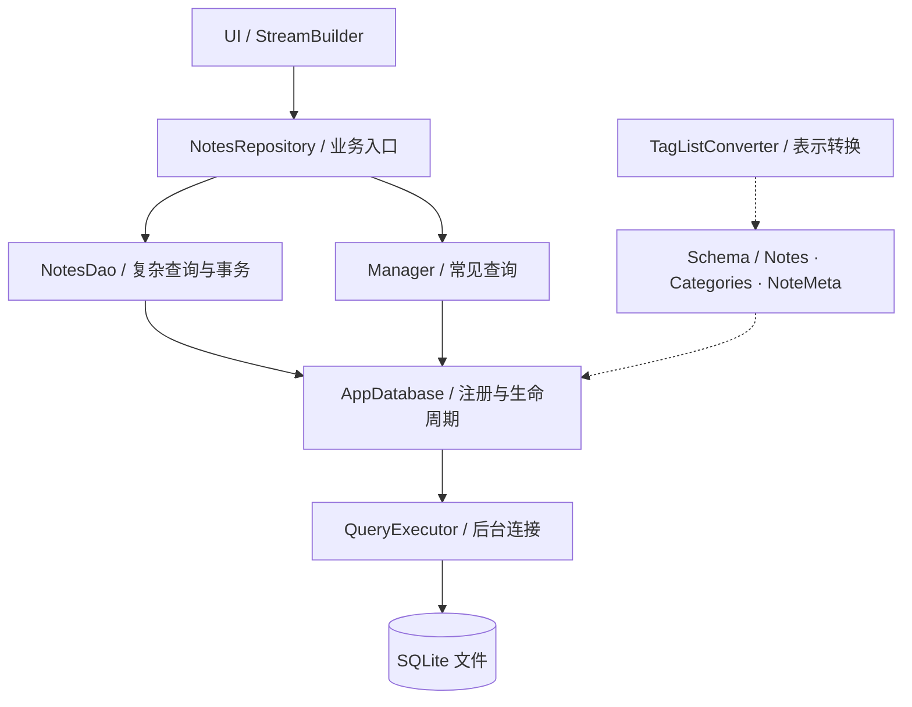
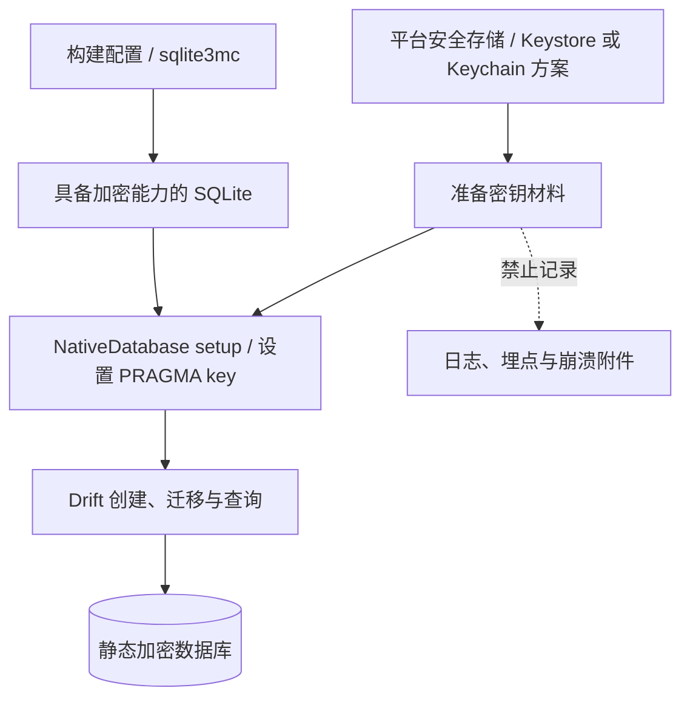
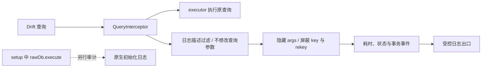

> 从一个笔记应用出发，划清 Schema、生成代码与客户端安全的边界。

Drift 的价值不只是少写几条 SQL，而是把类型安全、响应式查询和迁移工具接到同一套开发流程里。真正容易出问题的，却往往是“全特性都开了”之后：新安装正常，老用户升级失败；数据库加密了，口令却进了日志；表拆得很细，生成文件仍然不断膨胀。

我的建议是：不要把全特性理解为配置项全开，而要让每项能力都有责任边界、验证方法和退出条件。下面以 `drift_best_practices_sample` 的笔记模型为线索，讨论上线前最值得投入的几个环节。

<!-- truncate -->

:::tip 先看结论

先保存可重放的 Schema 历史，再接入安全存储与脱敏观测；最后根据实测结果决定是否使用 modular 或读连接池。**功能开关不是上线凭证，验证结果才是。**

:::

## 阅读地图：先区分「写了代码」与「验收通过」

| 关注点 | 示例当前状态 | 距离上线还差什么 |
| --- | --- | --- |
| Schema / Converter / DAO / Manager | 已有源码与生成配置 | 跑通代码生成、静态分析与业务测试 |
| 事务 / batch / upsert / watch | 已有实现与部分测试代码 | 补回滚、边界值和异常路径测试 |
| v1→v2 迁移 | 手写 Migrator；steps 仅为注释指引 | 历史快照、stepByStep 与真实迁移测试 |
| sqlite3mc 加密 | 可选连接钩子；默认关闭 | 依赖对齐、安全存储、release 与存量库验证 |
| 脱敏追踪 | 已有 RedactingInterceptor | 审计 SQL 字面量、异常与上报链路 |
| modular / server_sync | 未接入 | 独立评估收益，不算现有能力 |

:::info 本文中的「已实现」是什么意思

这里指工程中能找到对应源码，不代表已经编译、测试或通过平台验收。示例 README 明确说明尚未执行生成命令；迁移测试文件也是注释桩。下文会把现有模式和待接入方案分开标注。

:::

## 一、Schema 管结构，DAO 管动作，Manager 管常见查询

示例把表放在 `lib/database/tables/`，转换器、DAO、连接和追踪分别独立，`AppDatabase` 负责注册与生命周期。`NotesRepository` 给 UI 提供业务入口，不让页面到处构造 Companion。这是示例采用的分层选择，不是 Drift 强制的架构。

### 1.1 先画清责任边界



图中实线是调用路径，虚线是定义与注册关系。Schema 不是运行时业务服务，Manager 也不是 DAO 上面必须再套的一层；业务可以按查询复杂度选用两种入口。

`Notes` 关联 `Categories`，`NoteMeta` 用文本 `key` 作主键。外键声明不等于运行时检查已开启：示例在 `beforeOpen` 执行 `PRAGMA foreign_keys = ON`。这个回调每次打开数据库都会运行；首次填充数据应通过 `details.wasCreated` 判断，不能无条件插入。参见[迁移与打开回调](https://drift.simonbinder.eu/migrations/)。

简单筛选可以用生成的 [Manager](https://drift.simonbinder.eu/dart_api/manager/)；复杂查询和“创建分类并写入首条笔记”这样的原子业务动作，则集中在 `NotesDao`。事务边界应跟业务一致，不能靠 UI 连续调用两次写入假装原子操作。`seedMeta` 演示 batch，`upsertMeta` 演示 `insertOnConflictUpdate`，不要把两者的冲突策略混为一谈。

### 1.2 Converter 解决表示，不替代建模

Converter 也应该是模型设计的一部分。示例的 `TagListConverter` 将 `List<String>` 映射为 JSON 文本，列定义如下：

```dart
// Notes 表中的定义
TextColumn get tags => text()
    .map(const TagListConverter())
    .withDefault(const Constant('[]'))();
```

它还混入 `JsonTypeConverter2<List<String>, String, List<Object?>>`，区分 SQL 中的字符串与数据类 JSON 中的数组，避免二次编码。普通 `TypeConverter` 默认只负责 Dart 与 SQL 的转换，不会自动接管数据类的 JSON 序列化，见[官方转换器说明](https://drift.simonbinder.eu/type_converters/)。

选择 JSON 列之前，还应想清楚查询方向：如果标签只是随笔记整体读写，文本 JSON 很直接；如果经常按标签过滤、统计和关联，独立标签表及关联表通常更便于表达约束。Converter 解决的是表示转换，不会替你完成关系建模。

不要顺手把 Converter 写成“坏数据一律吞掉”。示例对非数组返回空列表、对元素调用 `toString()`，但非法 JSON 仍可能抛异常；生产项目应明确兼容策略并补测试。另外，tags 使用列表不意味着生成数据类就有你预期的深度值相等语义，涉及去重与状态比较时要单独验证。

:::tip 事务验收要测失败的一半

`createCategoryWithNote` 的成功路径只能说明两次写入都完成了。更有价值的测试是：让第二次写入失败，再确认第一次写入没有残留。batch 关注批量执行，事务关注业务原子性，别用“批量写得快”替代一致性设计。

:::

## 二、迁移不是补一段 DDL，而是保存可重放的历史

示例当前 `schemaVersion` 为 2，v1→v2 增加默认值为 0 的 `Notes.priority`，实际代码仍是手写 `onUpgrade`。它适合解释机制，但不该被误认为已经接入完整迁移流水线。

:::warning stepByStep 尚未接入

工程当前实际执行的是手写 `onUpgrade`，下面的扩展写法需要先生成步骤文件、补齐历史快照再接线。不要把注释中的示例当成现有迁移保障。

:::

### 2.1 从初始快照开始，而不是从事故开始


[官方推荐的工作流](https://drift.simonbinder.eu/migrations/)有一个容易漏掉的前提：**第一次改表之前就导出初始 Schema**。随后每次改表、提升版本、执行 `dart run drift_dev make-migrations`，补全迁移步骤并运行测试。工具生成快照、步骤文件和测试骨架，不会替你决定数据转换的业务语义。

登记位置在 `build.yaml` 的 `databases.app_database`，对应 `lib/database/app_database.dart`。拿到生成的 `app_database.steps.dart` 后，可按示例注释和官方模式改成下面的结构；这是待接入写法，不是工程当前已启用的代码：

```dart
// 放在 app_database.dart，导入生成的 app_database.steps.dart 后使用
extension Migrations on GeneratedDatabase {
  OnUpgrade get schemaUpgrade => stepByStep(
    from1To2: (m, schema) async {
      await m.addColumn(schema.notes, schema.notes.priority);
    },
  );
}
// MigrationStrategy 中使用：onUpgrade: schemaUpgrade
```

重点是 `schema.notes`，不是当前数据库的 `notes` getter。把逻辑抽到 `GeneratedDatabase` 的扩展，能减少误用最新表结构的机会：今天写的 v1→v2，不能在未来新增列后悄悄变成“按 v5 结构迁移”。`stepByStep` 也支持正确停在中间目标版本。

### 2.2 结构一致，只是迁移验收的第一层

验证至少分两层。先用 `SchemaVerifier` 检查升级后的结构，再写数据完整性断言：旧笔记仍在、内容不变、新列为预期默认值。下面摘编自工程的迁移测试桩，前提是已有生成的 `GeneratedHelper` 和历史快照：

```dart
final verifier = SchemaVerifier(GeneratedHelper());
final connection = await verifier.startAt(1);
final db = AppDatabase.forExecutor(connection);
try {
  await verifier.migrateAndValidate(db, 2);
} finally {
  await db.close();
}
```

[迁移测试文档](https://drift.simonbinder.eu/migrations/tests/)说明，结构验证会语义比较建表语句；它不是“数据没有丢”的证明。当前工程没有历史快照，`migration_test.stub.dart` 也全是注释。不能只在 v2 状态首次运行工具，就宣称已经覆盖真实 v1 升级。

| 验证对象 | 应该回答的问题 | 不能代替什么 |
| --- | --- | --- |
| 新建库 | 从空库能否创建最新结构？ | 老用户升级 |
| 历史库升级 | DDL 能否到达目标版本？ | 业务数据仍正确 |
| 数据完整性 | 正文、关联和默认值是否符合预期？ | 真实设备的加密与文件行为 |

测试样本不要只有一条“干净笔记”。至少包含空正文、多个标签、空分类、较长内容，以及升级前真实存在的数据。历史版本越多，越要覆盖用户可能跳过中间版本的升级路径；测试应从已保存的历史结构出发，而不是临时手造一个近似版本。

## 三、加密先核对依赖，再谈密钥管理

[当前官方加密方案](https://drift.simonbinder.eu/platforms/encryption/)使用 `NativeDatabase` 配合 SQLite3MultipleCiphers：通过 `hooks.user_defines.sqlite3.source: sqlite3mc` 选择构建，在 `setup` 中、Drift 使用数据库之前执行 `PRAGMA key`。示例的 `openAppConnection` 沿用了这个模式，默认 `enableEncryption = false`。

### 3.1 引擎、密钥和开库顺序是三件事

下面画的是生产接入目标，不是示例已完成的密钥实现。平台安全存储在加密开库前准备材料，敏感值不进入观测链路。



:::warning 先解决版本约束，再验证加密

这里必须指出一个版本坑：**示例仍声明 `sqlite3: ^2.9.0`，而当前文档描述的 hooks 路线对应 sqlite3 3.x。** 不要直接复制 pubspec 就认为加密生效；应先对齐 Dart/Flutter SDK 与依赖约束，完成依赖解析、代码生成和目标平台验证。

:::

### 3.2 安全存储不是硬编码口令的包装器

`debugOnlyPassphrase` 只是教学占位，不是生产安全存储实现。生产密钥应通过平台安全存储方案接入 Android Keystore / iOS Keychain，禁止硬编码、埋点或写入崩溃附件；拼接 PRAGMA 时也要正确转义。示例检查 `PRAGMA cipher`，但用的是 `assert`，不能当作 release 模式的强制保障。是否在加密不可用时拒绝开库，应形成明确的运行时策略。

安全存储方案还要回答备份恢复与密钥丢失的问题：换机后能否重新获取密钥？密钥失效时是重新同步还是提示恢复？不要在开库失败时静默删除文件并重建，那会把密钥问题伪装成“用户数据突然没了”。这些是产品与工程共同决定的恢复策略，不是 ORM 能自动选择的默认行为。

另一个边界是存量明文库：官方明确说明，不能直接对已有明文数据库执行 `PRAGMA key` 就完成加密，需要按文档设计复制、转换与替换流程。加密迁移应单独验证，不能混进普通升版后靠一次启动“看起来正常”来验收。

## 四、追踪要看耗时，不要顺手收集用户数据

[官方 Tracing 示例](https://drift.simonbinder.eu/examples/tracing/)展示了 `QueryInterceptor` 的完整接入，但其中的 `$statement with $args` 是机制演示，不是生产日志规范。绑定参数里可能就是正文、手机号或凭证。

### 4.1 把观测分成执行通道与输出通道



脱敏针对的是输出描述，不是把真实参数替换成星号再交给数据库。保留这条边界，才能同时保证查询正确性与日志安全。

工程通过 `lazy.interceptWith(RedactingInterceptor(redactArgs: true))` 安装拦截器，保留耗时、成功失败与事务事件，并在 `_describe` 中隐藏参数及敏感 PRAGMA：

```dart
// RedactingInterceptor._describe 的核心逻辑
final lower = statement.toLowerCase();
if (lower.contains('pragma key') || lower.contains('pragma rekey')) {
  return '«sensitive pragma omitted»';
}
final shown = args.map((_) => '***').toList(growable: false);
return '$statement with $shown';
```

:::danger 密钥和业务正文不能成为排障素材

不要直接记录 `args`，也不要把整段错误对象当作“只有工程师看得到”的安全内容。日志一旦进入聚合平台、工单或截图，访问范围往往比数据库本身更广。

:::

### 4.2 默认脱敏不等于没有泄漏

但这还不是完整脱敏方案。SQL 字面量仍可能包含明文，样例 `_run` 的异常日志也直接输出 `$e`；生产应进一步审查错误对象，优先记录查询标识、耗时、操作类型和安全错误码。字符串匹配 key/rekey 只是兜底，不能替代“不把秘密拼进可记录 SQL”的纪律。

还要注意，`setup` 里的 `rawDb.execute` 并不是经过 Drift executor 发出的查询，不能指望这个拦截器替原生初始化日志兜底。脱敏必须覆盖日志、异常上报与调试工具的整条链路。

## 五、生成优化与运行时优化，分开处理

示例 `build.yaml` 开启 `generate_manager`、`fatal_warnings`、DateTime 文本存储等选项。它们不是一套通用性能开关：[官方生成配置](https://drift.simonbinder.eu/generation_options/)明确说明，`sql.options.version` 与 `modules: [fts5, json1]` 只是静态分析假设，不会替运行时安装扩展；DateTime 存储格式也应在建模时确定，存量变更需要评估迁移。

### 5.1 配置项不是一张性能许愿单

| 配置或机制 | 实际作用 | 常见误解 |
| --- | --- | --- |
| `generate_manager` | 生成常见 CRUD 接口 | 开启后查询就会更快 |
| `fatal_warnings` | 将生成阶段警告升级为失败 | 可以替代测试 |
| `sql.options.modules` | 告诉分析器可用的 SQL 扩展 | 会安装运行时扩展 |
| modular | 拆分生成库并管理导入 | 只是把手写文件拆目录 |
| `createInBackground` | 把原生数据库执行放到后台 isolate | 自动优化慢 SQL |

面对生成膨胀，先确认是否真的使用 Manager、`toCompanion` 等能力，再决定裁剪。`skip_verification_code` 虽能减少代码，却会降低无效写入的错误提示质量，不应只为文件行数好看而打开。

更大的工程可以评估[模块化生成](https://drift.simonbinder.eu/generation_options/modular/)：关闭默认 builder，启用 `drift_dev:analyzer` 与 `drift_dev:modular`，共享 options，并把 `part` 调整为生成库的 `import`。仅仅把手写表拆成多个文件，不会自动拆分默认的大型生成文件；当前示例也尚未启用 modular。

优化之前最好留一份可比较的基线：记录干净构建与增量生成耗时、分析器响应，以及真实设备上的首屏查询耗时。生成文件变小不等于安装包同比变小，后台 isolate 也不会让低效查询自动变快。先定位瓶颈，再决定是调整生成、查询还是连接方式。

### 5.2 先测慢在哪里，再决定开多少连接

运行时则是另一件事：SQLite 同步执行可能阻塞 UI isolate，示例用 `NativeDatabase.createInBackground` 把数据库放到后台。通常先用单个后台 isolate，确有慢读竞争再评估 `readPool` 与 WAL，不要一开始就堆连接。参见[原生平台文档](https://drift.simonbinder.eu/platforms/vm/)。数据库实例应由依赖注入层统一持有并负责 `close()`，而不是页面各开一个。

## 六、安全与同步，都不要越过客户端边界

:::danger 客户端不是可信计算边界

静态加密不是“不可提取”，QueryInterceptor 也不是 IDS。用户能控制的终端不能作为权限与资金事实的最终裁判。

:::

[FAQ](https://drift.simonbinder.eu/faq/)明确指出，Drift 数据库文件可以从设备提取并检查。静态加密提高文件离线读取的门槛，不意味着客户端进程和密钥永远不可提取。Drift 不是 IDS，查询拦截也不等于入侵检测；权限、权益、余额等关键事实必须以服务端校验为权威，不能因为本地记录“看起来合法”就信任。

同步同理：Drift 不自动完成前后端同步。可以从[官方 server_sync 页面](https://drift.simonbinder.eu/examples/server_sync/)评估变更日志或 PowerSync，但幂等、冲突处理与上传鉴权仍需要设计；本文示例没有实现同步。

## 收尾：把能力清单变成验收清单

示例可供阅读的能力包括 Schema、Converter、DAO/Manager、事务、batch、upsert、watch、后台连接与脱敏追踪；内存库测试覆盖了 watch、事务成功路径和 upsert，但不等于覆盖回滚、历史迁移或加密。

### 上线验收 Checklist

把验收结果放进 CI 记录或发布说明，而不是只在群里说一句“本地测过了”。对失败项记录负责人与处理策略：例如迁移失败如何保留原库、加密不可用是否拒绝启动、日志抽检由谁完成。这样下一位维护者看到的是可重复的流程，而不是一组只在作者机器上成立的约定。

上线前，我会至少勾完下面五项：

- [ ] 对齐 SDK、Drift 与 sqlite3 版本，实际跑通依赖解析、生成、分析和测试。
- [ ] 保存每个发布版本的 Schema，验证升级路径与历史数据，补充事务失败回滚测试。
- [ ] 接入平台安全存储，验证 release 加密失败策略及存量明文库转换。
- [ ] 检查 SQL、参数、异常、埋点与崩溃附件，确认没有泄密链路。
- [ ] 明确实例生命周期、生成策略与服务端权威，不把未实现能力当作已有保障。

好的 Drift 实践，不是让数据库层看起来功能齐全，而是让下一次升级、排障和安全审查都有据可查。

## 附：Docusaurus 展示接入说明

:::info 图表需要站点启用 Mermaid

本文使用原生 Markdown、Mermaid 围栏与 Docusaurus admonitions，不依赖自定义 React 组件。站点需安装 `@docusaurus/theme-mermaid`，并在现有配置中合并以下选项；**不要覆盖原有 themes 或 markdown 配置**。作者 front matter 仍是占位，发布前请替换为本人署名或已有作者 key。

:::

```js
// docusaurus.config.js：合并到现有配置
export default {
  markdown: { mermaid: true },
  themes: ['@docusaurus/theme-mermaid'],
};
```

配置依据：[Mermaid 图表](https://docusaurus.io/docs/markdown-features/diagrams)、[提示块](https://docusaurus.io/docs/markdown-features/admonitions)、[博客元数据](https://docusaurus.io/docs/blog)。代码高亮语言支持与标签规则以实际站点配置为准；若启用了严格的 tags 校验，还需在站点标签文件登记本文标签。HTML 导出版把 Mermaid 保留为可读源码，不加载外部脚本。

***

*材料边界：本文核对了示例源码与上述官方页面。示例 README 声明尚未运行生成与测试，本次环境亦无 Dart/Flutter SDK，故不声称工程已编译通过。指定 Canvas 页面因当前工具未提供 `ReadCanvas`，未能直接核读。*


